<p align="center">
  
</p>

```console
kalex440@github:~$ git log --graph --all
```

<p align="center">
  <picture>
    <source media="(prefers-color-scheme: dark)" srcset="https://raw.githubusercontent.com/Kalex440/Kalex440/output/snake-dark.svg">
    
  </picture>
</p>

```console
kalex440@github:~$ stats --streak --total
```

<p align="center">
  
  
</p>

```console
kalex440@github:~$ activity --last 31d
```

<p align="center">
  
</p>

```console
kalex440@github:~$ exit
```
